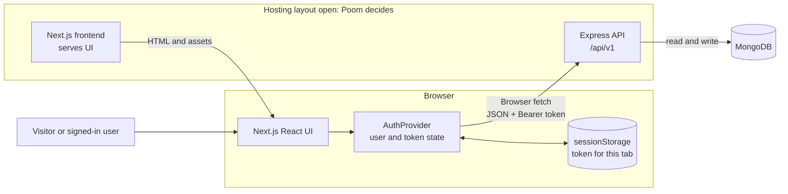

# System design

This diagram is the proposed system shape for the joint design review. It describes logical parts, not a deployed setup. The frontend and backend scaffold, integration, and deployment are still pending.

Next.js serves the interface. After it loads, React runs in the browser. The browser restores the tab's token, checks `/auth/me`, and sends API requests directly to Express with `Authorization: Bearer <token>`. The Next.js server does not make these authenticated API calls. The frontend needs only a public API base URL; MongoDB credentials and `JWT_SECRET` stay on the backend.

## Responsibilities

| Part | Responsibility and status |
|---|---|
| Next.js frontend | Planned App Router pages and React components. `AuthProvider`, API client, guards, forms, and role-based navigation are planned in [FRONTEND-PLAN.md](FRONTEND-PLAN.md); they are not implemented yet. |
| Express API | Existing behavior reviewed at the pinned backend revision in [API.md](API.md). Its auth middleware verifies bearer tokens; route middleware checks roles, and rental controllers check ownership. |
| MongoDB | Stores users, equipment, and rental requests through backend models. The browser never connects to it. |

Frontend guards and hidden buttons guide navigation; they do not secure data. Express remains responsible for authentication and authorization. Public registration currently accepts a `role` value including `admin`; this existing backend behavior is recorded for the class demo and is not changed by this design. Use prepared demo accounts.

## Hosting and request path

The frontend and Express API are separate logical services. Whether they use one or two Vercel projects, their URLs, and whether `/api/v1` shares a domain or crosses origins remain open. A cross-origin browser request needs the backend CORS origin configured. See [deployment options](DEPLOYMENT-OPTIONS.md). Backend request and response fields are recorded in [API.md](API.md); the proposed shared TypeScript contracts are in [SHARED-CONTRACTS.md](SHARED-CONTRACTS.md) and await Poom's review.

## Backend source

Backend facts refer to [`be18df9`](https://github.com/SWDevPrac2-69-1/PJ02-EquipmentRent/tree/be18df9967be7e0a742b5a5ae25f07966dc4e1d4), especially [`middleware/auth.js`](https://github.com/SWDevPrac2-69-1/PJ02-EquipmentRent/blob/be18df9967be7e0a742b5a5ae25f07966dc4e1d4/middleware/auth.js), [`routes/rentals.js`](https://github.com/SWDevPrac2-69-1/PJ02-EquipmentRent/blob/be18df9967be7e0a742b5a5ae25f07966dc4e1d4/routes/rentals.js), and [`controllers/rentals.js`](https://github.com/SWDevPrac2-69-1/PJ02-EquipmentRent/blob/be18df9967be7e0a742b5a5ae25f07966dc4e1d4/controllers/rentals.js). This is source review, not a runtime or deployment result.
