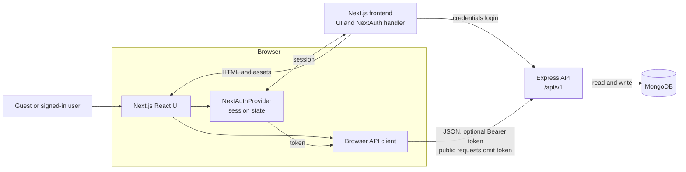

# System design

This document records the confirmed frontend foundation and retained system proposals. The updated [Figma design](FIGMA.md) defines the base screens and product behavior. The [November 18 decisions](FRONTEND-PLAN.md#confirmed-decisions) supplement it.
The backend and database details below are separate integration references. The course PDFs do not define product requirements.

The proposed system has a Next.js frontend, an Express API, and MongoDB. The hosting layout remains open. Poom owns that choice. The diagram shows logical responsibilities, not a deployed setup.
The user allows backend changes when confirmed behavior requires them. The [API guide](API.md) continues to describe the supplied revision until that backend changes.

Next.js and Express are separate logical services. Their hosting arrangement remains open. Next.js serves the interface. React runs in the browser after the page loads. NextAuth manages the session through its Next.js handler. The credentials handler calls backend login.
Protected API helpers send the backend token with `Authorization: Bearer <token>`. Public requests omit the token.
The diagram groups session handling logically. It does not describe cookie storage or every request between the browser and NextAuth.

The frontend needs an API base URL and private NextAuth server configuration. MongoDB credentials and backend `JWT_SECRET` stay on the backend.

## Responsibilities

| Part | Responsibility |
|---|---|
| Next.js frontend | Planned App Router pages, React components, authentication provider, API client, access guards, forms, and role-based navigation. See [frontend plan](FRONTEND-PLAN.md). |
| Express API | Auth middleware verifies bearer tokens. Route middleware checks roles. Rental controllers check ownership. See [API guide](API.md). |
| MongoDB | Backend models store users, equipment, and rental requests. The browser does not connect to MongoDB. |

Figma's guest, member, and admin equipment variants share browser URLs. The proposed frontend selects the variant from the current account state.
Guest equipment list and detail pages use public API reads. Home keeps its minimal content and remains separate from the catalog.
Login to request opens Login without retaining an item or destination. Login, registration, and logout always go to Home.
The member rental creation path is `/equipments/[id]/rent`. Admins manage existing requests and cannot create them.
One date-range calendar input maps to the backend's separate start and return date fields.
The frontend derives displayed cost as the current equipment rate times inclusive calendar days, without quantity. Round the final total once to two decimals with halfway values rounded upward. The backend does not store or calculate that cost, and older displayed totals change when equipment rates change.

Frontend guards and hidden buttons guide navigation. They do not secure data. Express enforces authentication and authorization. Public registration accepts a `role` value that includes `admin`; the class demo intentionally keeps Member and Admin signup.

## Hosting and request path

The frontend and Express API are separate logical services. Poom owns the hosting choice. A cross-origin browser request needs the backend CORS origin configured.

The backend request and response fields are in [API.md](API.md). The TypeScript interfaces are in [SHARED-CONTRACTS.md](SHARED-CONTRACTS.md).

## Backend source

Backend facts refer to commit [`be18df9`](https://github.com/SWDevPrac2-69-1/PJ02-EquipmentRent/tree/be18df9967be7e0a742b5a5ae25f07966dc4e1d4), especially [`middleware/auth.js`](https://github.com/SWDevPrac2-69-1/PJ02-EquipmentRent/blob/be18df9967be7e0a742b5a5ae25f07966dc4e1d4/middleware/auth.js), [`routes/rentals.js`](https://github.com/SWDevPrac2-69-1/PJ02-EquipmentRent/blob/be18df9967be7e0a742b5a5ae25f07966dc4e1d4/routes/rentals.js), and [`controllers/rentals.js`](https://github.com/SWDevPrac2-69-1/PJ02-EquipmentRent/blob/be18df9967be7e0a742b5a5ae25f07966dc4e1d4/controllers/rentals.js).
