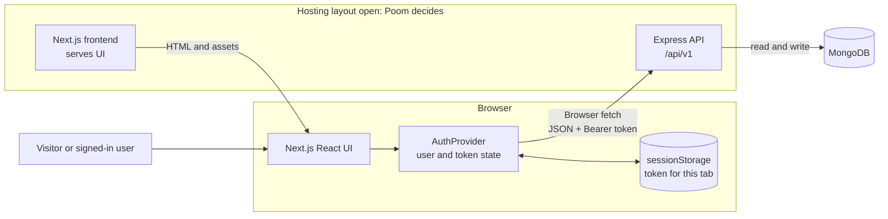

# System design

The proposed system has a Next.js frontend, an Express API, and MongoDB. The hosting layout remains open. Poom owns that choice. The diagram shows logical responsibilities, not a deployed setup.

Next.js serves the interface. React runs in the browser after the page loads. The browser restores the tab token, calls `/auth/me`, and sends API requests to Express with `Authorization: Bearer <token>`. The Next.js server does not make these authenticated API calls.

The frontend needs a public API base URL. MongoDB credentials and `JWT_SECRET` stay on the backend.

## Responsibilities

| Part | Responsibility |
|---|---|
| Next.js frontend | Planned App Router pages, React components, authentication provider, API client, access guards, forms, and role-based navigation. See [frontend plan](FRONTEND-PLAN.md). |
| Express API | Auth middleware verifies bearer tokens. Route middleware checks roles. Rental controllers check ownership. See [API guide](API.md). |
| MongoDB | Backend models store users, equipment, and rental requests. The browser does not connect to MongoDB. |

Frontend guards and hidden buttons guide navigation. They do not secure data. Express enforces authentication and authorization. Public registration currently accepts a `role` value that includes `admin`. Use prepared demo accounts.

## Hosting and request path

The frontend and Express API are separate logical services. Their project count, URLs, and shared-domain routing remain open until Poom selects a hosting layout. A cross-origin browser request needs the backend CORS origin configured. See [deployment options](DEPLOYMENT-OPTIONS.md).

The backend request and response fields are in [API.md](API.md). The TypeScript interfaces are in [SHARED-CONTRACTS.md](SHARED-CONTRACTS.md).

## Backend source

Backend facts refer to commit [`be18df9`](https://github.com/SWDevPrac2-69-1/PJ02-EquipmentRent/tree/be18df9967be7e0a742b5a5ae25f07966dc4e1d4), especially [`middleware/auth.js`](https://github.com/SWDevPrac2-69-1/PJ02-EquipmentRent/blob/be18df9967be7e0a742b5a5ae25f07966dc4e1d4/middleware/auth.js), [`routes/rentals.js`](https://github.com/SWDevPrac2-69-1/PJ02-EquipmentRent/blob/be18df9967be7e0a742b5a5ae25f07966dc4e1d4/routes/rentals.js), and [`controllers/rentals.js`](https://github.com/SWDevPrac2-69-1/PJ02-EquipmentRent/blob/be18df9967be7e0a742b5a5ae25f07966dc4e1d4/controllers/rentals.js).
